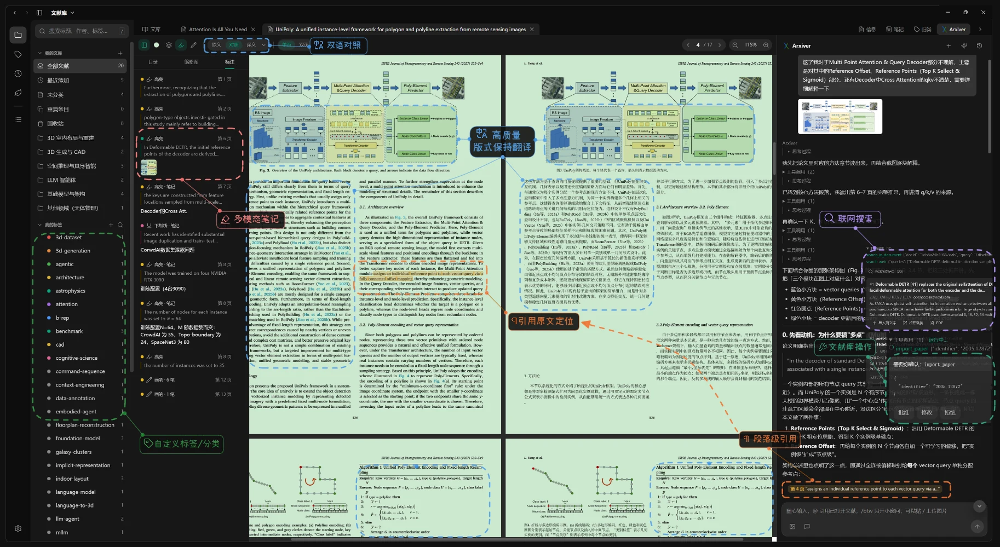
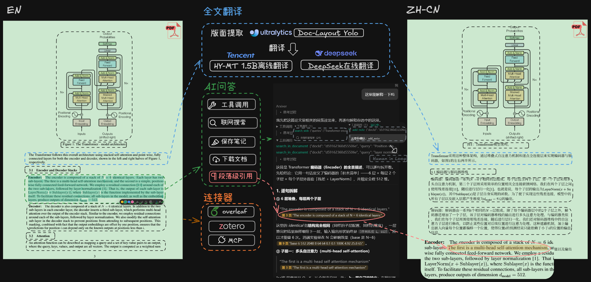
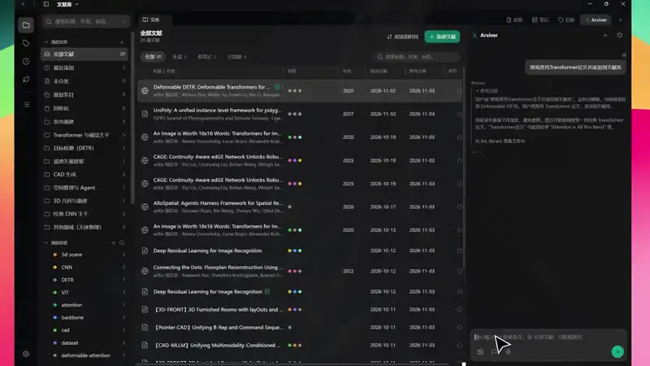
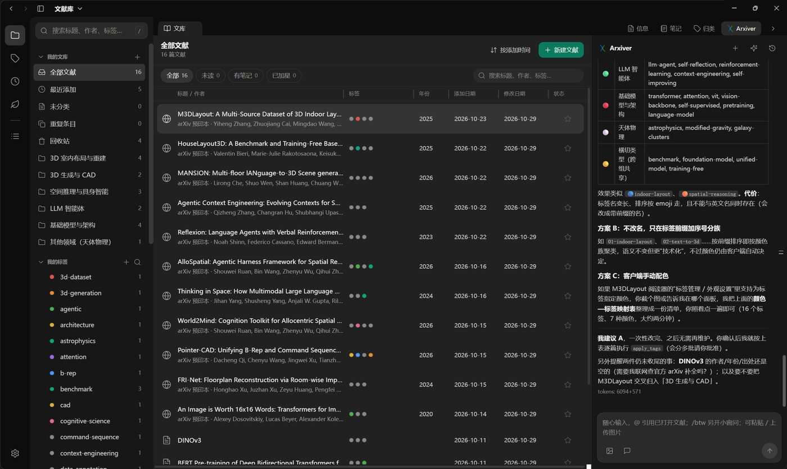
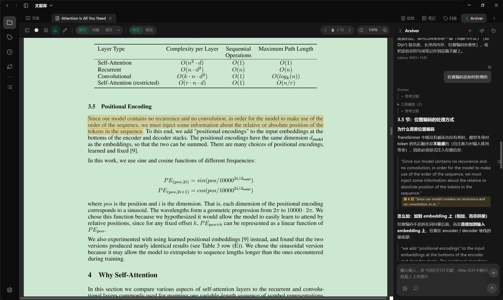
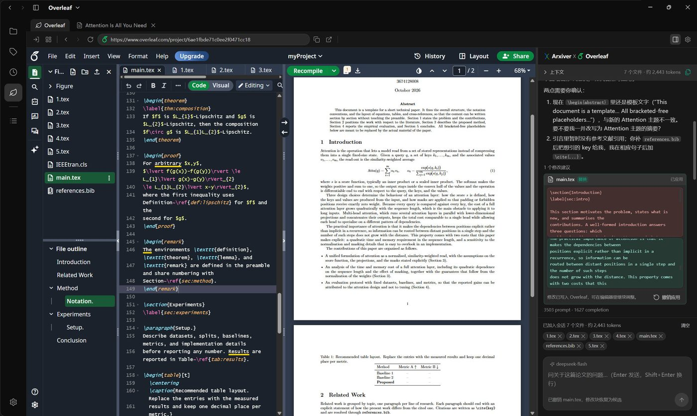
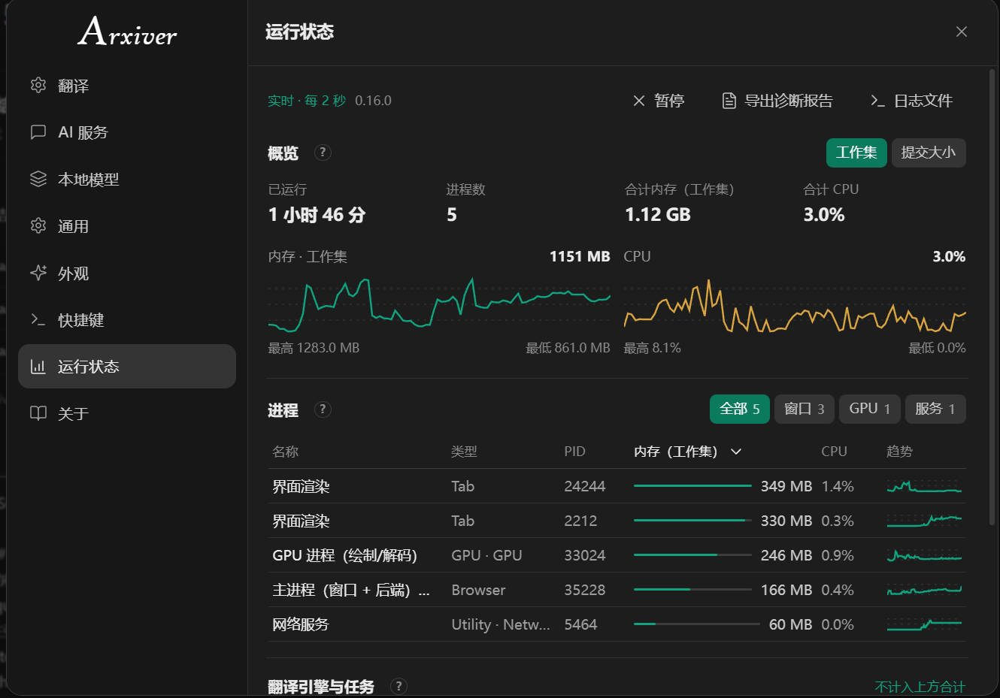

<p align="center">
  
  &#160;&#160;
  
  
</p>

<h3 align="center">高质量版式保持的论文翻译，与引用可溯源的 AI 阅读助手。</h3>

<p align="center">
  <b>面向理工科论文阅读 · 本地或在线 · 无需订阅 · 开源</b>
</p>

<p align="center">
  <a href="https://github.com/SheriocCode/Arxiver/releases/latest"></a>
  
  
  
</p>

<p align="center">
  <a href="https://github.com/SheriocCode/Arxiver/releases/latest"></a>
  &#160;
  <a href="https://sherioccode.github.io/arxiver/"></a>
  &#160;
  <a href="https://sherioccode.github.io/arxiver/#changelog"></a>
</p>




Arxiver 是一款面向科研阅读的 Windows 桌面应用，用于英文论文的中文翻译与辅助阅读。翻译在保留原 PDF 版面与图表的前提下进行，既可使用内置 HY-MT2 模型在本机完成，也可接入任意 OpenAI 兼容接口；支持本地 PDF 与 arXiv / DOI 导入。

阅读器提供原文、对照、译文三种视图，翻译过程中即可逐页阅读；段落块框可回溯原文，译文与原文的版面位置一一对应。AI 助手基于当前论文或整个文献库作答，引用标注页码与原文片段，可直接定位至 PDF 对应位置。

# 视频演示
[](https://github.com/SheriocCode/Arxiver/raw/main/assets/README/index.mp4)

点击画面播放完整演示（约 2 分 34 秒，含声音）。

完整的使用说明、参考与更新日志见 **[文档 · sherioccode.github.io/arxiver](https://sherioccode.github.io/arxiver/)**。

## 核心能力

- **保留原版面的论文翻译**：图表、公式与段落位置保持一致，原文 / 对照 / 译文三视图逐页对照，段落块框可回溯原文。
- **引用可溯源的 AI 助手**：基于当前论文或整个文献库作答，引用标注页码与原文片段，可直接定位至 PDF 对应位置。
- **本地或在线，无需订阅**：内置 HY-MT2 + llama.cpp 支持本机离线翻译，无需 API Key；也可接入任意 OpenAI 兼容接口（费用由服务商收取）。
- **覆盖论文阅读全流程**：支持 arXiv / DOI / 本地 PDF 导入，提供分类、标签、笔记、标注、目录、缩略图与页面主题。
- **Overleaf 工作区**：内嵌 Overleaf，AI 可按需读取项目文件，修改建议经确认后写入。

## 界面

<table>
<tr>
<td width="50%">
  
  <br><sub><b>文献库</b>：分类、标签、笔记与检索</sub>
</td>
<td width="50%">
  
  <br><sub><b>AI 助手</b>：回答标注页码与原文片段，可直接定位至 PDF</sub>
</td>
</tr>
<tr>
<td width="50%">
  
  <br><sub><b>Overleaf</b>：内嵌工作区，修改建议确认后写入</sub>
</td>
<td width="50%">
  
  <br><sub><b>运行状态</b>：进程、内存 / CPU 与翻译任务</sub>
</td>
</tr>
</table>

更多截图与视频演示见 [文档 · 界面与演示](https://sherioccode.github.io/arxiver/#demo)。


## 下载与安装

1. 在 [Releases](https://github.com/SheriocCode/Arxiver/releases/latest) 下载 Windows 安装包并安装（当前约 280 MB，不含模型）。
2. 首次使用到「设置 → 本地模型」下载模型：版面识别约 72 MB（任何翻译都需要），本地翻译模型约 1.1 GB（仅本地模式需要），GPU 加速包约 35 MB（可选）。
3. 导入本地 PDF 或粘贴 arXiv / DOI 链接，打开后点「翻译」，在阅读器中切换 原文 / 对照 / 译文。
4. 需要 AI 助手时，在「设置 → AI 服务」配置 OpenAI 兼容接口；联网搜索需另配服务商 Key。

> 模型下载支持 HuggingFace / hf-mirror / ModelScope 等镜像，校验通过后启用；升级不会重复下载未变化的文件。

## 系统要求

| 项目 | 要求 |
| --- | --- |
| 系统 | Windows 10 / 11（64 位） |
| 安装包 | 约 280 MB（不含模型） |
| 安装后占用 | 约 0.9 GB（不含模型） |
| 模型 | 版面识别约 72 MB；本地翻译约 1.1 GB；GPU 加速包约 35 MB（可选） |
| 内存 | 建议 8 GB 及以上 |
| 显卡 | 可选；Vulkan 加速包，无可用显卡或驱动时自动回退 CPU |
| 网络 | 本地翻译与阅读不需要网络；下载模型、导入 arXiv / DOI、在线翻译、AI 助手与联网检索需要 |

## 数据与隐私

- 数据默认保存在 `<安装目录>\data`（设置、文库、译文、模型、日志与技能）；卸载默认保留，安装目录不可写时回退到 `%APPDATA%\Arxiver`。
- 使用本地模型时，翻译与版面识别都在本机完成，论文内容不会上传；切换到在线接口时，内容会发送到你配置的服务商。
- AI 助手只在你配置接口后联网；联网搜索只发送检索式与待读取的网址，不上传本地文献。
- 应用不包含遥测上报。

## 已知限制

- 扫描版 PDF 暂不支持 OCR，纯图片页面无法提取文字。
- 复杂多栏、公式与图表混排的版面偶尔需要人工检查。
- 本地模型优先保证离线与零边际成本，翻译质量不追求超过大型在线模型。

## 开发

```powershell
cd electron-app
npm install
npm run dev        # 开发运行
npm run typecheck  # tsc（node + web）
npm run build      # electron-vite 构建
npm run dist       # 打包安装包（electron-builder）
```

目录结构：

```text
electron-app/   Electron 主进程、React 界面与 Python 翻译引擎
icons/          品牌资源
tools/          打包、发布与文档脚本
```

本地打包用 `tools/build.ps1`，发布用 `tools/publish.ps1`。

## 第三方许可

- **PDF.js**（Mozilla，Apache-2.0）：PDF 渲染与文本层。
- **HY-MT**（腾讯混元，Apache-2.0）：本地翻译模型，在应用内按需下载。
- **llama.cpp**（MIT）：本地翻译推理运行时。
- **ONNX Runtime**（MIT，含 DirectML 执行后端）：版面识别。
- **BabelDOC / PyMuPDF**（AGPL-3.0）：翻译引擎与文本抽取。
- **KaTeX**（MIT）、**react-markdown / remark / rehype**（MIT）：Arxiver 回答渲染。
- 图标集移植自 **Lucide**（ISC）。
