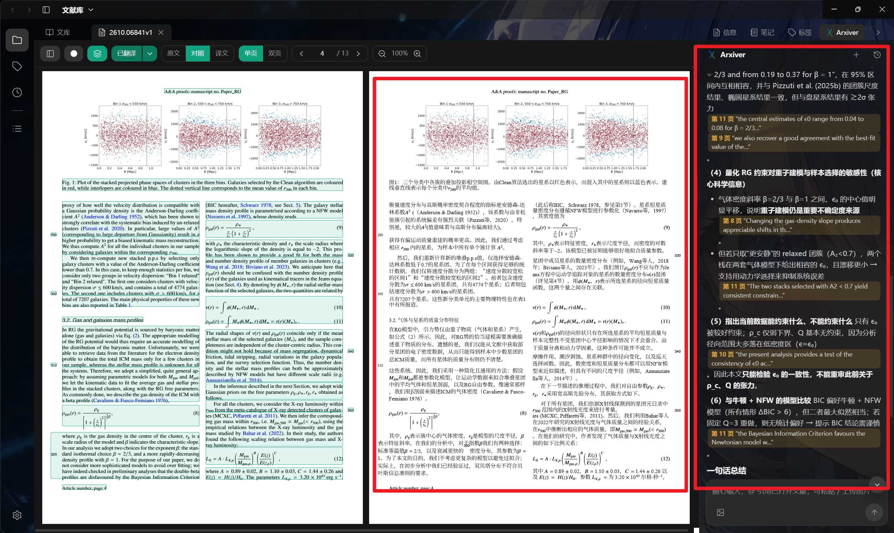
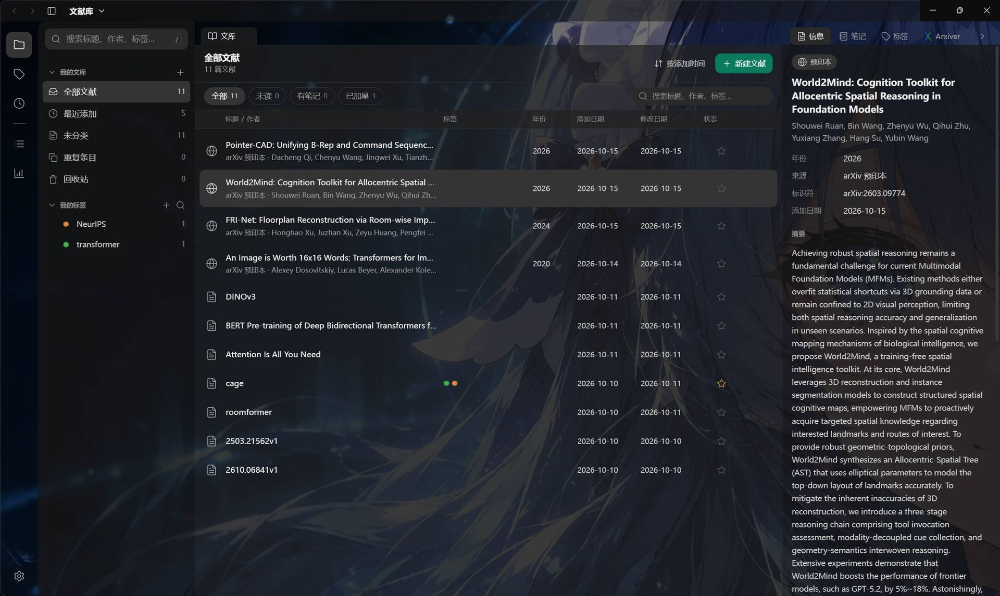
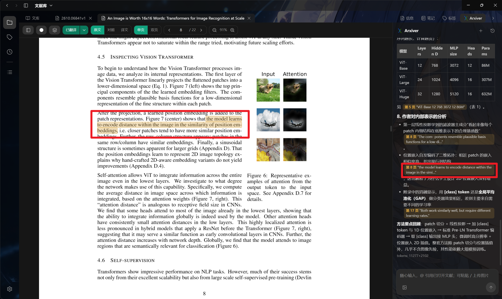
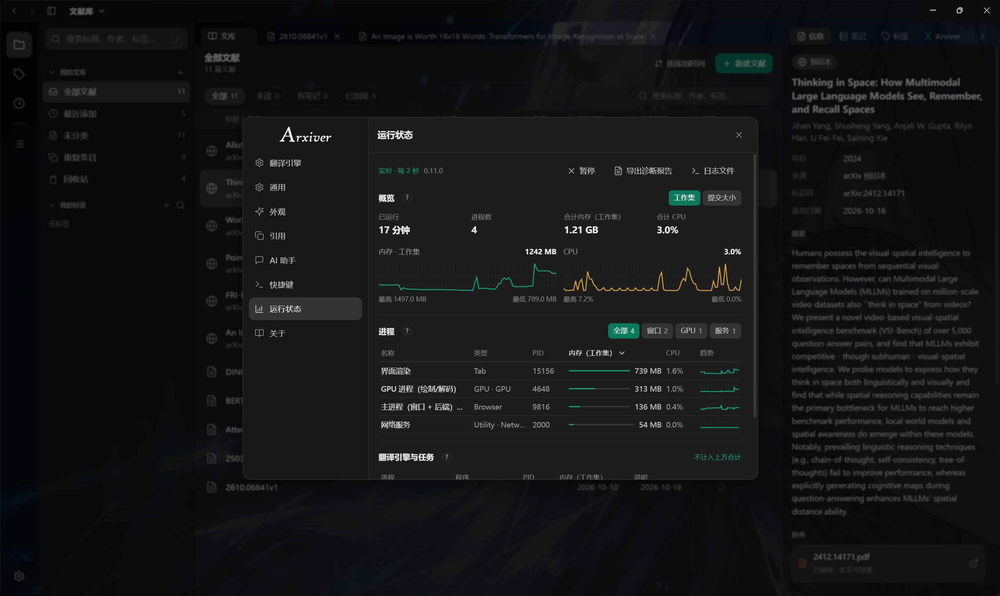
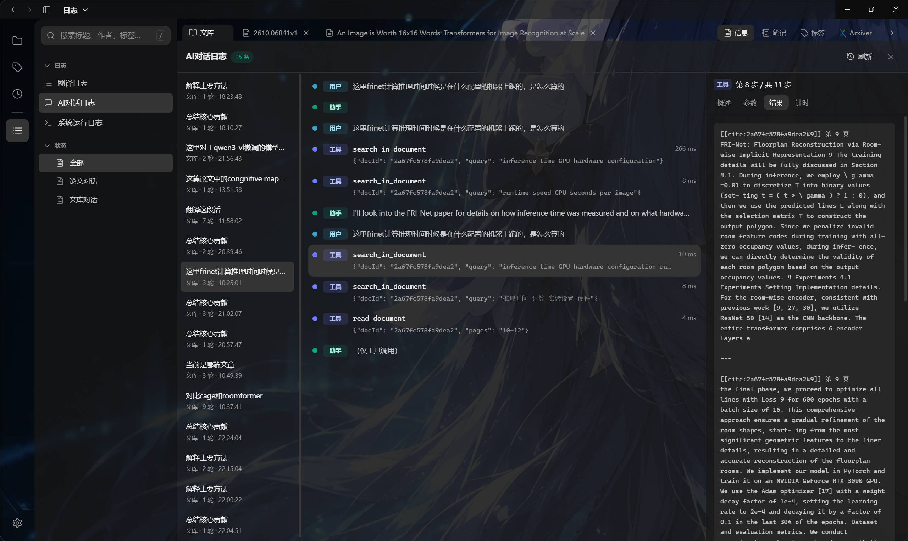

<p align="center">
  
  &#160;&#160;
  
  
</p>

<h3 align="center">在 Windows 上离线翻译论文，双语对照阅读，并让 AI 助手带着原文引用回答。</h3>

<p align="center">
  <b>本地翻译 · 无需 API Key · 文献与数据不离开本机</b>
</p>

<p align="center">
  <a href="https://github.com/SheriocCode/Arxiver/releases/latest"></a>
  
  
  
</p>

<p align="center">
  <a href="https://github.com/SheriocCode/Arxiver/releases/latest"></a>
  &#160;
  <a href="https://sherioccode.github.io/Arxiver/"></a>
  &#160;
  <a href="https://sherioccode.github.io/Arxiver/guide.html"></a>
</p>

<p align="center">
  <a href="https://sherioccode.github.io/Arxiver/changelog.html">更新日志</a> ·
  <a href="https://github.com/SheriocCode/Arxiver/issues">问题反馈</a>
</p>



## 为什么值得一试

- **真正离线、零翻译费用**：内置 HY-MT 翻译模型与 llama.cpp 运行时，安装即用，不需要 API Key，论文内容不会上传到翻译服务。
- **不是“把 PDF 丢给在线翻译”**：保留原 PDF 版面，原文 / 对照 / 译文三视图并排阅读，段落块框可随时展开查看「原文 → 译文」。
- **为论文阅读设计**：粘贴 arXiv 链接或 DOI 自动获取元信息；文献库支持分类、标签、笔记、回收站；目录、缩略图、页面主题一应俱全。
- **AI 助手带原文引用**：可以问当前论文，也可以跨文献检索；回答里的引用能精确到 **页码 + 段落**，点击直接跳到 PDF 并高亮原文。
- **数据留在本机**：文库、笔记、译文与阅读历史都保存在本地。AI 助手只有在你自己配置在线接口后才会联网。

## 截图

<table>
<tr>
<td width="50%">
  
  <br><sub><b>文献库</b>：分类、标签、搜索、元信息与摘要</sub>
</td>
<td width="50%">
  
  <br><sub><b>AI 助手</b>：跨文献提问，引用可精确到段落并高亮</sub>
</td>
</tr>
<tr>
<td width="50%">
  
  <br><sub><b>运行状态</b>：进程、内存 / CPU 趋势、翻译任务与诊断报告</sub>
</td>
<td width="50%">
  
  <br><sub><b>日志追溯</b>：翻译与 AI 工具调用的完整步骤、耗时和 Token</sub>
</td>
</tr>
</table>

## 功能

### 翻译与阅读

- 本地离线翻译：HY-MT + llama.cpp；有 NVIDIA 显卡走 GPU，无独显 / 驱动不匹配自动回退 CPU。
- 原文 / 对照 / 译文三视图，单页 / 双页、缩放、目录大纲与缩略图、护眼 / 米黄 / 暗色页面主题。
- 按页进度、可取消长任务、块级流式预览；翻译过程中就能先看前面几页。
- 段落块框：在原文上标出文本块，点击查看原文与对应译文（公式占位符可显示真实内容）。

### 文献库

- 导入本地 PDF、拖拽导入，或粘贴 arXiv 链接 / 编号 / DOI 自动抓取元信息。
- 分类树、彩色标签、笔记、星标 / 已读、回收站、重复条目、全文搜索。
- 导入与补全元数据时显示当前阶段、下载大小与百分比。

### Arxiver 助手

- 基于当前论文或整个文库回答，先检索 / 阅读证据再作答。
- 回答附带可点击引用，支持 **页码 + 段落级定位与高亮**。
- 可联网检索 arXiv / 会议 / 期刊并读正文；`@` 引用已打开文献，选中文字直接提问。
- 标签、元数据、导入论文等写操作先弹确认卡片，不擅自修改文库。
- 会话历史、工具调用轨迹与 Token 统计都可追溯。

### 工程与维护

- Electron 桌面端 + 内置 Python 翻译引擎，安装包自带运行时与模型。
- 自动更新（差量更新）、运行状态面板、诊断报告导出。
- AI 助手与翻译使用独立接口；不配置 AI 接口不影响离线翻译。

## 快速开始

1. 从 [Releases](https://github.com/SheriocCode/Arxiver/releases/latest) 下载 Windows 安装包并安装。
2. 首次启动即可直接翻译：**本地模型离线运行，无需 API Key**。
3. 导入本地 PDF 或粘贴 arXiv 链接，打开后点「翻译」，在阅读器里切换 原文 / 对照 / 译文。
4. （可选）需要对话式助手时，在「设置 → AI 助手」填入 OpenAI 兼容接口；需要联网检索时再配置搜索服务商。

## 系统要求

| 项目 | 要求 |
| --- | --- |
| 系统 | Windows 10 / 11（64 位） |
| 安装包 | 约 1.8 GB（含本地翻译运行时与模型） |
| 安装后占用 | 约 3.2 GB |
| 内存 | 建议 8 GB 及以上 |
| 显卡 | 可选；NVIDIA 显卡可加速，无独显自动使用 CPU |
| 网络 | 翻译 / 阅读不需要；AI 助手与联网检索需要 |

> 首次启动或首次翻译时，杀毒软件可能会扫描较大的本地运行时；机械硬盘上会慢一些，之后会恢复正常。

## 隐私

- 翻译在本机完成，论文内容不会发送给任何翻译服务。
- 文库存放在 `%APPDATA%\Arxiver`，卸载时默认保留。
- AI 助手只在你配置了接口后联网；发送内容取决于你选择的服务商与是否使用联网搜索。
- 联网搜索只发送检索式，不上传本地文献内容。

## 已知限制

- 扫描版 PDF 暂不做 OCR，纯图片页面无法直接提取文字。
- 复杂多栏、公式、图表混排的版面偶尔需要人工检查；翻译质量取决于本地模型。
- 本地模型优先保证离线与零边际成本，质量不追求超过大型在线模型。
- 安装包较大；后续会通过拆分 CPU / GPU 组件、代码签名等方式继续优化首次启动体验。

## 开发

```powershell
cd electron-app
npm install
npm run dev        # 开发运行
npm run typecheck  # tsc（node + web）
npm run build      # electron-vite 构建
npm run dist       # 打包安装包（electron-builder）
```

目录结构：

```text
electron-app/
  src/main/       主进程：IPC、文库、翻译引擎、Agent、更新
  src/renderer/   React 界面、PDF.js 阅读器、状态管理
  engine/         Python 翻译引擎、本地模型与运行时
site/             Jekyll 文档站源文件
docs/             文档站构建产物
tools/            打包、发布、文档构建脚本
```

本地打包用 `tools/build.ps1`，发布用 `tools/publish.ps1`（详见 `NOTES.local.md`）；文档站见 `site/`，构建产物在 `docs/`，用 `tools/build-docs.ps1` 生成。

## 第三方许可

- **PDF.js**（Mozilla，Apache-2.0）：PDF 渲染与文本层。
- **HY-MT**（腾讯混元，Apache-2.0）：随应用分发的本地翻译模型。
- **llama.cpp**（MIT）：本地翻译推理运行时。
- **ONNX Runtime**（MIT，含 DirectML 执行后端）：版面识别。
- **BabelDOC / PyMuPDF**（AGPL-3.0）：随引擎分发的翻译引擎与文本抽取。
- **KaTeX**（MIT）、**react-markdown / remark / rehype**（MIT）：Arxiver 回答渲染。
- 图标集移植自 **Lucide**（ISC）。
